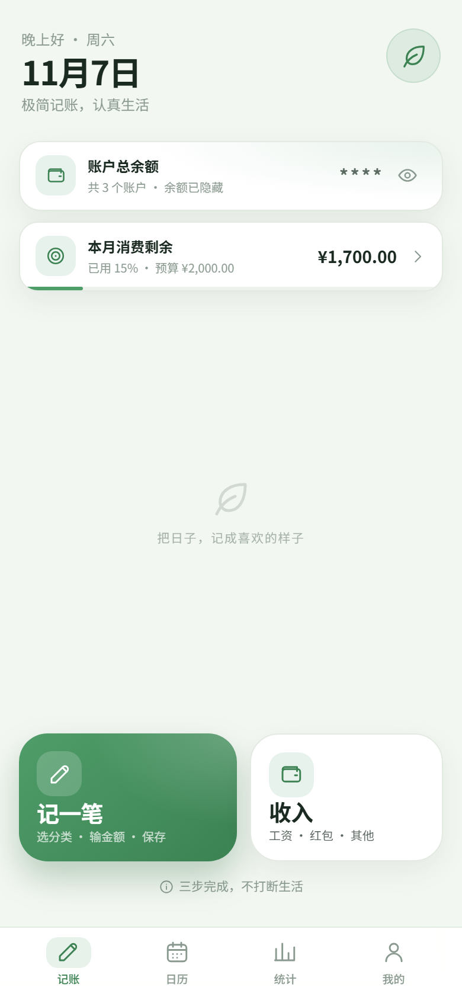
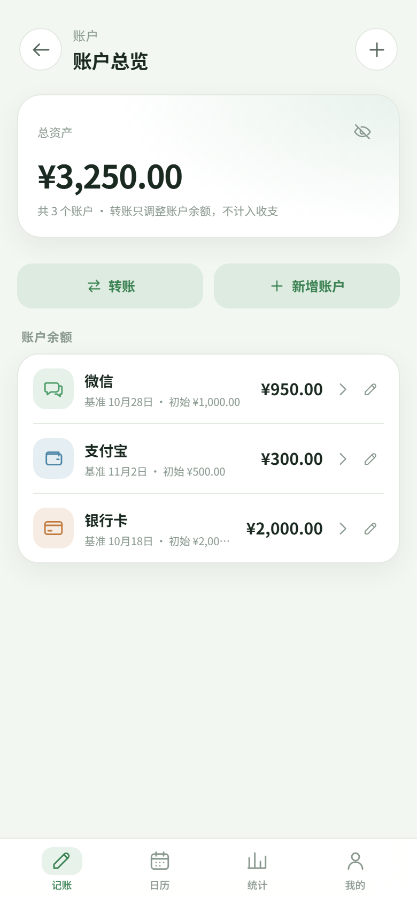
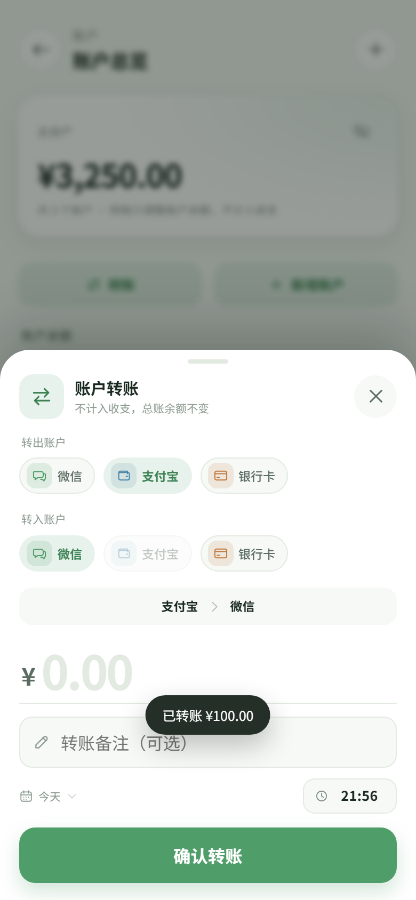

# 记把好账 v2.0.0

极简、无广告、纯本地的中文记账 App。WebView + 单文件页面，数据只保存在本机，**没有网络权限**。

当前版本：`2.0.0 (33)` · 包名 `com.qinghe.ledger` · 最低 Android 8.0（API 26）

## 功能

- **多账户**：默认微信、支付宝、银行卡；可新增账户，修改名称 / 图标 / 颜色。
- **独立余额**：每个账户单独设置「初始余额 + 基准日期」，从基准日期起单独计算。
- **总资产**：所有账户余额之和；首页「账户总余额」点击进入账户总览。
- **账户明细**：查看单个账户的余额、本月收入 / 支出 / 转入 / 转出和全部流水。
- **转账**：账户间互转，总资产不变，不计入收入、支出、预算和统计；可编辑 / 删除。
- **总账统计**：日历、日汇总、月度预算、消费分类、报表默认按总账核算。
- **按账户统计**：统计页可切换总账 / 单个账户；单账户统计时隐藏预算口径的累计结余。
- **记账**：自定义数字键盘、两级分类、日期时间、备注；每笔支出 / 收入必须选择账户。
- **解锁安全**：6 位数字密码 + 可选设备指纹；错误递增锁定；切后台 / 闲置重新验证。
- **完全离线**：无 `INTERNET` 权限；页面直接从 assets 读入 WebView，外部链接拦截。
- **本地能力**：悬浮球、通知栏快捷、状态栏磁贴、JSON 备份 / 恢复、CSV / Excel 导出。
- **隐私**：总资产和账户余额默认打码，点小眼睛显示；锁定期间不渲染账目、不弹金额提示。

首页总账：



账户总览：



转账：



## 安装包

- `dist/记把好账-2.0.0.apk`
- SHA-256：`CB8383FF20D2FDD3ABAEEB4BBFF3D6C5875EF51368E9E3363AA0389BC6220F75`
- 签名：Android 调试证书（`CN=Android Debug`），与上游 v1.6.13 不同，不能直接覆盖安装。

升级保留数据：

1. 旧版「我的 → 数据备份 → 导出」保存 JSON。
2. 卸载旧版。
3. 安装 `记把好账-2.0.0.apk`。
4. 首次打开设置 6 位解锁密码。
5. 「我的 → 数据备份 → 恢复」选择 JSON。

旧单账户余额 / 旧账单会自动迁移到「银行卡」账户。

## 目录

```text
index.html                 页面骨架 + SVG 图标
css/app.css                移动端样式 / 深色模式
js/util.js                 日期、金额、下载工具
js/store.js                localStorage、账户、账单、预算、统计
js/security.js             密码哈希、解锁锁定、指纹桥状态
js/importer.js             CSV / XLSX 本地解析
js/charts.js               零依赖 SVG 图表
js/app.js                  页面、交互、解锁页、账户与转账
assets/                    PWA 图标
android/                   Android WebView 壳（Gradle 工程）
dist/                      单文件页面、PWA zip、APK、安装说明
docs/                      多账户 / 解锁安全 / iOS 安装说明
tools/                     单文件构建、PWA 构建、CDP 测试脚本
shots/                     验收截图
```

## 构建

前置：JDK 17、Android SDK 36、Gradle 8.13；Node 22+ 仅测试脚本需要。

```powershell
# 1. 生成单文件页面
python tools/build_single.py
Copy-Item dist/记把好账.html android/app/src/main/assets/index.html -Force

# 2. 打包 Android
$env:JAVA_HOME = "C:\path\to\jdk-17"
$env:ANDROID_HOME = "C:\path\to\android-sdk"
$env:ANDROID_USER_HOME = "C:\path\to\.android-home"
$env:GRADLE_USER_HOME = "C:\path\to\.gradle-home"
& "C:\path\to\gradle-8.13\bin\gradle.bat" -p android :app:assembleRelease --offline
```

APK 输出：`android/app/build/outputs/apk/release/app-release.apk`。

本仓库的 Gradle release 使用本机 Android 调试证书签名（`signingConfig = debug`），可直接侧载；正式上架请替换为自己的签名配置，且不要提交 keystore。

## 权限

```text
android.permission.SYSTEM_ALERT_WINDOW
android.permission.POST_NOTIFICATIONS
android.permission.USE_BIOMETRIC
android.permission.USE_FINGERPRINT
android.permission.FOREGROUND_SERVICE
android.permission.FOREGROUND_SERVICE_SPECIAL_USE
android.permission.REQUEST_IGNORE_BATTERY_OPTIMIZATIONS
```

- **没有 `INTERNET`**，没有存储 / 通讯录 / 定位 / 相机权限。
- 指纹权限只用于本地 `BiometricPrompt`，不上传任何生物识别数据。
- 悬浮窗用于悬浮球快捷记账；通知用于常驻快捷入口。

## 测试

开发时通过 CDP 在真实页面跑：

```powershell
python serve.py
# 另开 headless Edge，监听 9222
node tools/run_smoke.mjs          # 原有 66 项
node tools/verify_security.mjs    # 解锁安全 28 项
node tools/verify_accounts.mjs    # 多账户 / 转账 47 项
```

## 文档

- [多账户-v2.0.0](docs/多账户-v2.0.0.md)
- [解锁安全-v1.9.0](docs/解锁安全-v1.9.0.md)
- [安装说明](dist/多账户-2.0.0-安装说明.md)
- [iOS PWA 安装](docs/ios-install.md)

## 说明

- 单用户、人民币、本地存储；卸载或清除数据会删除账单，请定期备份。
- 当前仓库没有连接 adb 设备，未做真机安装和真实指纹传感器测试。
- 本仓库基于上游 `Bruce3q/jibahaozhang` 的 `qinghe-ledger` 源码修改，已移除联网能力并增加多账户、转账、解锁安全。
